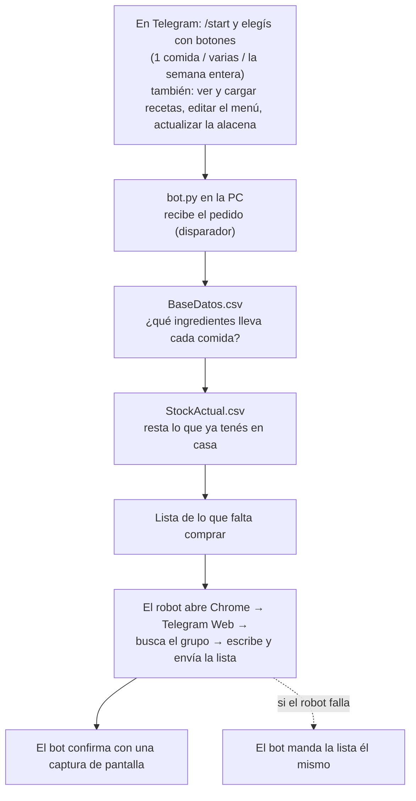
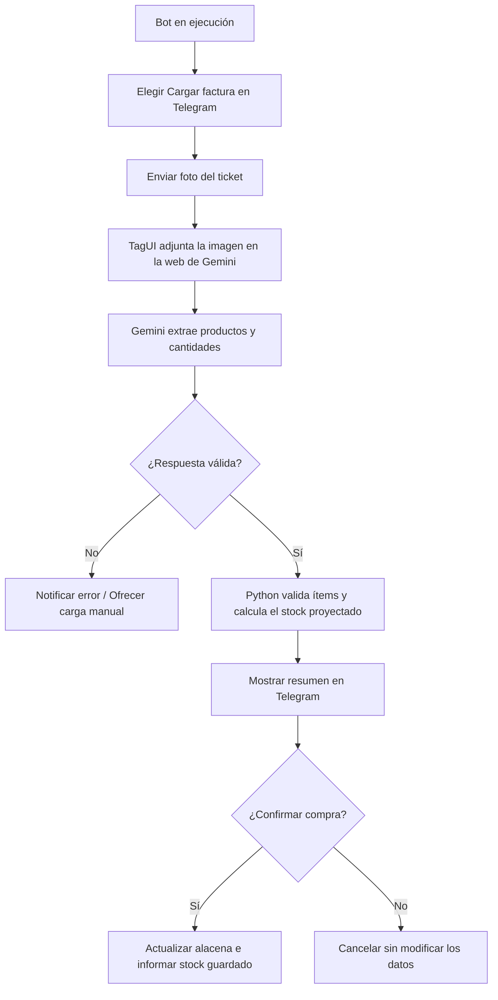

# Etapa 1 — Bot de compras de supermercado — TPI RPA Grupo 13

Automatización RPA hecha en **Python con la librería `rpa`** (RPA for Python, que por
dentro usa **TagUI**) para la materia Tecnologías para la Automatización (UTN FRCU,
Ingeniería en Sistemas de Información, 2026).

Le pedís al bot de Telegram qué querés cocinar. El proceso local calcula qué falta
comprar a partir de las recetas y de lo que hay en la alacena, y después **el robot hace
lo que haría una persona**: abre Chrome, entra a Telegram Web, busca el grupo y le
escribe la lista.

## Cómo funciona



El bot de Telegram es solo el **disparador**; la parte RPA es el proceso local que
interactúa con la máquina como un usuario (lee los CSV y maneja el navegador).

## Arranque rápido

Esto asume que ya instalaste Python y las librerías, creaste el bot y el grupo, e
iniciaste sesión en Telegram Web. Si no, andá primero al
[instructivo de instalación](docs/instructivo-instalacion.md).

1. Copiá `config.ejemplo.txt` como `config.txt` y completalo (token, chat_id y nombre
   del grupo).
2. Verificá que el token ande (esto **no** le manda un mensaje a nadie), parado en
   `Ejecutables`:
   ```
   py prueba_conexion.py
   ```
   (en Linux: `python3 prueba_conexion.py`)
3. Prendé el bot:
   - **Windows:** doble click en `Ejecutables\iniciar_bot.cmd`
   - **Linux / macOS:** `./Ejecutables/iniciar_bot.sh`
4. En Telegram, mandale `/start` al bot.

> **La PC tiene que quedar prendida y desbloqueada** mientras el bot atiende: el robot
> maneja Chrome en la pantalla, y con la sesión bloqueada Chrome no dibuja las páginas.

## Qué es cada archivo

| Archivo | Qué es |
|---|---|
| `Ejecutables/bot.py` | **El programa principal.** Escucha a Telegram, muestra los botones, dispara el cálculo y el robot, y responde cómo salió. |
| `Ejecutables/compras.py` | El cálculo: lee los CSV, suma los ingredientes de las comidas elegidas y descuenta el stock. |
| `Ejecutables/robot_telegram_web.py` | **La parte RPA.** Maneja Chrome con la librería `rpa`: abre Telegram Web, busca el grupo y escribe la lista. También sirve para iniciar sesión y para probar a mano. |
| `Ejecutables/configuracion.py` | Lee `config.txt`. |
| `Ejecutables/prueba_conexion.py` | Verifica que el token de `config.txt` sea válido, **sin enviarle un mensaje a nadie**. Es la primera prueba a correr cuando algo no anda. |
| `Ejecutables/iniciar_bot.cmd` | Atajo para **Windows**: prende el bot con doble click. |
| `Ejecutables/iniciar_bot.sh` | Lo mismo para **Linux/macOS**. Hacen falta los dos porque Windows y Linux usan formatos de script distintos. |
| `requirements.txt` | Las librerías de Python que hay que instalar (`rpa` y `requests`). |
| `data/BaseDatos.csv` | Las recetas: qué ingredientes y qué cantidad lleva cada comida. Se pueden agregar desde el bot (➕ Cargar receta). |
| `data/Menu.csv` | El menú de la semana (qué se come cada día). Lo usa el botón "Menú de la semana", que también permite cambiarlo o sortear uno nuevo. |
| `data/StockActual.csv` | Lo que ya hay en la alacena, para descontarlo. Lo actualiza la persona desde el bot (🥫 Mi alacena). |
| `config.txt` | Tu token, tu chat_id y el nombre del grupo. **No se sube al repositorio** (está en `.gitignore`): cada integrante del grupo se arma el suyo. |
| `config.ejemplo.txt` | La plantilla de `config.txt`, con las instrucciones adentro. Esta sí se sube. |
| `mensaje.txt` / `captura.png` | Se regeneran solos en cada pedido: la última lista y la captura de Telegram Web. Quedan como evidencia local. |
| `docs/evidencia/` | Material del intento por WhatsApp y capturas de errores, guardado para la exposición. |
| `docs/explicaciones-archivos/` | Una explicación detallada de cada archivo de código: qué hace cada parte y cada función. |

## Documentación

| Documento | Para qué |
|---|---|
| [Documentación del proyecto](docs/documentacion-del-proyecto.md) | **Lo que pide la consigna del TPI:** herramienta elegida y por qué, definición del proceso (alcance, restricciones, controles), los 3 conceptos teóricos, cronología, riesgos y la mejora propuesta para la Etapa 2. |
| [Instructivo de instalación](docs/instructivo-instalacion.md) | Poner esto a andar desde cero: Python, Chrome, librerías, bot de Telegram, grupo, `config.txt` e inicio de sesión en Telegram Web. |
| [Instructivo de uso](docs/instructivo-uso.md) | Usarlo en el día a día: los botones, cómo cargar tus propias comidas, qué hacer cuando algo falla. |
| [Explicación de los archivos](docs/explicaciones-archivos/) | Qué hace cada parte del código, archivo por archivo. |

## Grupo 13

Barreto Martin · Carmona Julian · Casagrande Joaquin · Flegler Mateo · Graciani Juan Pablo · Joannas Damián

Docentes: Jaime Eliezer Piperno Szternfeld y Mauro Sander Dimuro.

---

# Etapa 2 — UTN FRCU – Tecnologías para la Automatización 2026

## 👥 Grupo
- **Número de grupo:** 5
- **Miembros:**
  - Aldecoa Ludmila
  - Bertoldi Juliana
  - Braun Molina Magalí
  - Rey Florencia
  - Scheffer Catalina

---

## 📦 Proyecto Recibido
Este repositorio parte del **Bot de Comidas del Grupo 13** (RPA con TagUI y Telegram). La documentación original de la Etapa 1 se encuentra en la carpeta `docs/` (instructivo de instalación, instructivo de uso y documentación del proyecto).

El bot original recibía un pedido por Telegram (una comida, varias o el menú semanal), calculaba qué ingredientes faltaban comparando las recetas con la alacena y un robot TagUI escribía la lista de compras en un grupo de Telegram Web desde la cuenta de la persona.

---

## 🤖 Descripción del Bot
- **Descripción:** El bot permite consultar y filtrar recetas según los ingredientes disponibles en la alacena; al abrir una receta, indica si se puede preparar o qué ingredientes faltan. También permite cargar facturas o tickets mediante una foto: Gemini reconoce los productos y sus cantidades, el sistema valida la respuesta, muestra cómo quedaría la alacena y espera la confirmación explícita del usuario antes de guardar la compra.
- **Tecnología usada:** Python, `rpa` (que utiliza TagUI) para automatizar el navegador, Telegram como interfaz y Gemini como servicio de IA con visión cognitiva para leer las imágenes.

### 🚀 Descripción de la Mejora
- **Cargar factura:** Se agregó al bot la opción **🧾 Cargar factura**. TagUI abre Gemini en segundo plano, adjunta la imagen enviada por el usuario y le solicita extraer los productos en un formato estructurado. Python valida los renglones, calcula el stock resultante y pide confirmación antes de guardar la compra en la alacena.
- **Consulta de recetas inteligente:** Se incorporó un filtro para distinguir las recetas que se pueden preparar con los ingredientes disponibles en la alacena, de las que todavía no. Al consultar una receta individual, el bot indica si está completa o detalla los ingredientes y las cantidades que faltan.
- **Motivación:** En la Etapa 1, la alacena debía actualizarse manualmente. Registrar las compras desde una foto reduce esa tarea repetitiva y ayuda a mantener actualizado el stock, conservando una instancia de verificación humana antes de modificar los datos.

---

## 🧠 Vínculo con la Teoría de Control y Automatización

- **Retroalimentación negativa (Lazo cerrado):** En la Etapa 1, el proceso actuaba en lazo abierto respecto a la alacena, ya que dependía de que una persona cargara el stock a mano. La mejora automatiza ese sensor: cada compra leída y confirmada realimenta el sistema actualizando el estado que mide el próximo cálculo de recetas. *(Nota: El lazo queda cerrado del lado de las compras; cocinar aún no descuenta stock).*
- **Elementos de medición y sensores (Transducción):** Gemini actúa como transductor: convierte información no estructurada de una imagen en variables digitales estructuradas (nombre, cantidad y unidad). Esa señal pasa por una etapa de acondicionamiento mediante un parser que valida y normaliza los datos antes de operar.
- **Perturbaciones exógenas y endógenas:** 
  - *Exógenas:* Fotos borrosas, unidades incompatibles (paquetes vs. kg), cambios repentinos en la interfaz web de Gemini o sesiones vencidas. Se mitigan mediante selectores de respaldo (*fallbacks*), tiempos de espera máximos (*timeouts*) y la confirmación obligatoria del usuario.
  - *Endógenas:* Congelamientos del navegador Chrome o fallas en el proceso background de TagUI.
- **Error en estado estable:** Si la lectura falla o la respuesta no es válida, la alacena no se modifica y se ofrece la carga manual: se prefiere mantener el estado previo que registrar datos erróneos en el sistema.

---

## 🛠️ Instrucciones de Instalación (Etapa 2)

### Requisito previo
Si es la primera vez que se ejecuta en la computadora, completar antes los pasos 2 a 5 del instructivo de la Etapa 1 (`docs/instructivo-instalacion.md`): crear el bot de Telegram, armar `config.txt` e iniciar sesión en Telegram Web.

### 🐧 Linux (Ubuntu / Debian)
Desde la terminal en la carpeta raíz del proyecto `team-13`:

1. Instalá los paquetes requeridos por Python y TagUI:
   ```bash
   sudo apt update
   sudo apt install -y python3 python3-venv python3-pip curl php-cli
   ```

2. Creá un entorno virtual e instalá las dependencias del proyecto:
   ```bash
   python3 -m venv .venv
   source .venv/bin/activate
   python -m pip install -r requirements.txt
   ```

3. Confirmá que `config.txt` esté en la raíz con sus credenciales correspondientes.

### 🪟 Windows
1. Instalá Python 3 (marcando **Add python.exe to PATH**) y Google Chrome.
2. Abrí la terminal en la raíz de `team-13` e instalá las dependencias:
   ```bat
   py -m pip install -r requirements.txt
   ```

---

## ▶️ Instructivo de Uso

### 1. Iniciar sesión en Gemini (Primera vez)
Ejecutá el comando correspondiente para abrir el navegador controlado por TagUI y autenticarte en Google Gemini:

**Linux:**
```bash
OPENSSL_CONF=/dev/null python -c 'import rpa as r; r.init(); r.url("https://gemini.google.com"); input("Inicia sesión en Gemini y presiona Enter para cerrar..."); r.close()'
```

**Windows (CMD / PowerShell):**
```bat
py -c "import rpa as r; r.init(); r.url('https://gemini.google.com'); input('Inicia sesión en Gemini y presiona Enter para cerrar...'); r.close()"
```

### 2. Ejecutar el Bot

**Linux:**
```bash
python3 Ejecutables/bot.py
```

**Windows (PowerShell):**
```powershell
.\iniciar_bot.cmd
```

---

## 🔍 Reproducción del Proyecto Ajeno y Observaciones

Al reproducir el proyecto heredado de la Etapa 1, se detectaron y documentaron los siguientes aspectos:

| Aspecto Encontrado | Detalle técnico | Sugerencia / Solución implementada |
| :--- | :--- | :--- |
| **Entorno Linux sin probar** | Faltaba instalar `curl`, vincular Python y ajustar la compatibilidad con OpenSSL. | Se documentaron e incluyeron los comandos de instalación requeridos. |
| **Formatos de script (CRLF)** | Los scripts guardados en Windows generaban errores `^M` en terminales Linux. | Se solucionó ejecutando `sed -i 's/\r$//' Ejecutables/*.sh`. |
| **PowerShell en Windows** | PowerShell requiere .\ antes del comando para ejecutar archivos en la carpeta actual. | Se aclaró el comando exacto en la guía de ejecución. |
| **Telegram Chat ID vacío** | `getUpdates` devuelve `result` vacío si el mensaje se envió a otro chat o no hay interacción previa. | Se añadió la aclaración en la documentación del flujo. |
| **Avisos de seguridad** | Telegram notifica un inicio de sesión externo al vincular el robot de navegación. | Se indicó en la guía que es un comportamiento normal y esperado. |

---

## 📊 Diagrama del Flujo de Carga de Factura



---

## ⚠️ Problemas Conocidos y Limitaciones
- **Calidad de imagen:** La precisión depende de la nitidez de la foto. La etapa de validación por parte del usuario es obligatoria para garantizar la integridad de los datos.
- **Conversiones de unidades:** Los tickets que cobran por paquete o unidad cuando la receta requiere masa/volumen (`kg` o `lt`) no se convierten automáticamente; requieren revisión manual.
- **Interfaces cambiantes:** Si Google modifica el diseño del sitio de Gemini, puede ser necesario actualizar la lista de selectores de respaldo (*fallbacks*) en `procesador_factura.py`.
